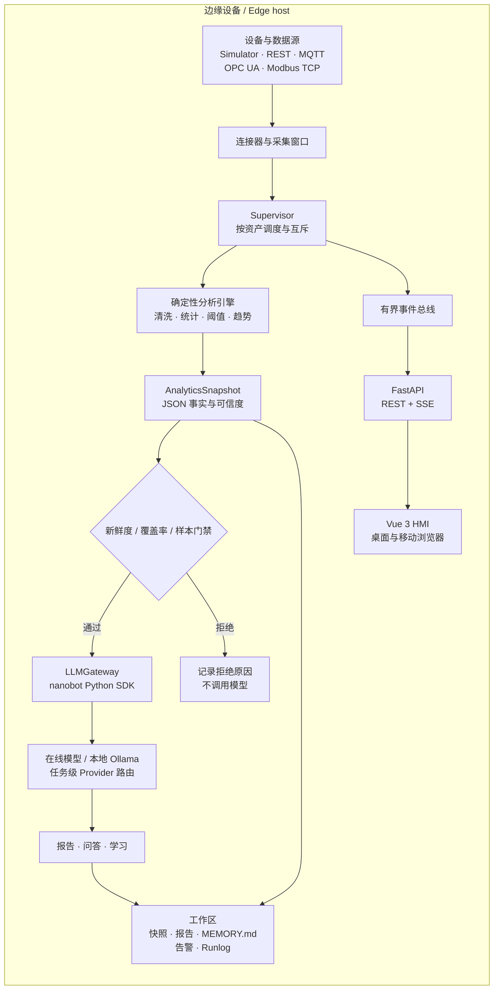
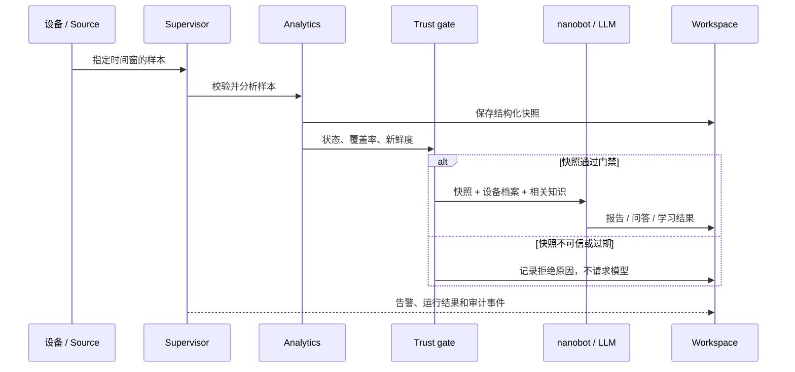

<div align="center">

# EdgeAdviser

### Trustworthy equipment intelligence at the edge
### 面向边缘现场的可信设备智能顾问

**Deterministic facts. Explainable decisions. Practical AI.**<br>
**确定性事实 · 可解释判断 · 实用 AI**

[](CHANGELOG.md)
[](pyproject.toml)
[](webui/package.json)
[](edge_adviser/server/app.py)
[](https://github.com/happy-momo/nanobot-dev/actions/workflows/ci.yml)

[中文](#中文) · [English](#english) · [Architecture](#技术架构) · [Quick start](#快速开始) · [Deployment](#deployment)

</div>

EdgeAdviser turns equipment telemetry into auditable snapshots, operational alerts, reports, and engineering Q&A. It combines deterministic time-series analysis with the [nanobot](https://github.com/happy-momo/nanobot-dev) Python SDK for language-model interpretation, and runs as an edge service with a browser-based HMI.

EdgeAdviser 将设备时序数据转化为可审计的分析快照、运行告警、报告和工程问答。它将确定性时序分析与 [nanobot](https://github.com/happy-momo/nanobot-dev) Python SDK 结合，并以边缘服务和浏览器 HMI 的形式运行。

> **Design rule / 设计原则:** numbers and trust decisions come from code; an LLM may explain those facts, but it does not invent them.
>
> 数值与可信度判断由代码计算；LLM 可以解释事实，但不负责编造事实。

> [!IMPORTANT]
> EdgeAdviser is an advisory and observability system, not a safety controller. Validate outputs with qualified personnel and keep PLC interlocks, protective trips, and site safety procedures independent.
>
> EdgeAdviser 用于辅助分析与观测，不是安全控制器。请由专业人员验证结果，并保持 PLC 联锁、保护跳闸和现场安全规程独立有效。

## 中文

### 能做什么

- **接入现场数据：**内置 Simulator、REST、MQTT、OPC UA 和 Modbus TCP 连接器。
- **计算可复核的事实：**对每个分析窗口生成结构化快照，包含统计量、覆盖率、数据新鲜度、阈值状态和趋势信息。
- **先判断数据是否可信：**样本不足、覆盖率低、数据过期或连续空窗口会被明确标记；门禁不通过时，问答与报告不会让模型猜测。
- **生成有来源的解读：**通过 nanobot SDK 路由到在线 Provider 或本地 Ollama；报告与问答基于快照、设备档案和相关知识。
- **形成运行闭环：**支持周期监控、定时报告、历史学习、操作员反馈、告警确认和审计记录。
- **浏览器现场 HMI：**Vue 3 单页应用由 FastAPI 提供，包含总览、告警、审计、配置与资产详情视图。
- **边缘部署：**支持单容器 Docker Compose，也支持 Linux systemd 裸机部署。

### 技术架构



#### 模块职责

| 层 | 主要职责 | 代码位置 |
|---|---|---|
| 配置与领域模型 | 资产、指标、阈值、数据源、调度和可信度策略 | [`edge_adviser/config/`](edge_adviser/config/) |
| 采集与连接器 | 统一采集接口及 Simulator、REST、MQTT、OPC UA、Modbus TCP | [`edge_adviser/ingest/`](edge_adviser/ingest/) |
| 确定性事实层 | 样本卫生、统计分析、状态和可信度门禁 | [`edge_adviser/analytics/`](edge_adviser/analytics/) |
| 调度与持久化 | 按资产采集、分析、归档；运行账本与设备知识存储 | [`edge_adviser/core/`](edge_adviser/core/) |
| AI 编排 | nanobot SDK 上下文注入、任务 Provider 选择和降级 | [`edge_adviser/llm/`](edge_adviser/llm/) |
| 业务服务 | 报告、问答、学习和操作员反馈 | [`edge_adviser/report/`](edge_adviser/report/), [`edge_adviser/qa/`](edge_adviser/qa/), [`edge_adviser/learn/`](edge_adviser/learn/) |
| 服务端与 HMI | FastAPI REST/SSE、事件流、告警、认证与 Vue 界面 | [`edge_adviser/server/`](edge_adviser/server/), [`webui/`](webui/) |

#### 从数据到结论



分析快照是事实主线；报告和问答保留其数据范围与 Provider 信息。历史学习只在配置的学习门禁允许时写入设备知识，避免把低质量数据固化为经验。

### 快速开始

#### 环境要求

| 组件 | 要求 | 用途 |
|---|---|---|
| Python | 3.11 或更高版本 | 后端、CLI、测试 |
| Node.js | 20 或更高版本 | 构建和测试 Web HMI |
| Docker Compose | 可选 | 容器化部署 |
| Ollama 或在线模型 | 可选 | AI 解读；本地演示不需要模型 |

#### 1. 安装开发依赖

在仓库根目录创建虚拟环境并安装 EdgeAdviser 与 nanobot 开发依赖。该命令与 EdgeAdviser CI 的依赖安装方式一致：

```bash
uv venv
uv pip install -e ".[edge-test]" -e "./edge_adviser" pytest pytest-asyncio
```

Windows PowerShell 可使用相同命令；虚拟环境解释器路径也可以显式传给 `uv pip`，例如 `.\.venv\Scripts\python.exe`。

#### 2. 构建 Web HMI

```bash
cd edge_adviser/webui
npm ci
npm test
npm run build
cd ../..
```

`npm run build` 会先执行 TypeScript 类型检查，再生成由 FastAPI 托管的静态文件。

#### 3. 无模型体验 Demo

```bash
cd edge_adviser
edge-adviser web config.demo.json
```

浏览器打开 [http://127.0.0.1:8000](http://127.0.0.1:8000)。Demo 使用确定性 MockGateway 和隔离的 `workspace-demo/`，启动时播种模拟设备、快照、报告与告警，不需要 API Key 或 Ollama。Demo 数据仅用于体验，不能作为现场设备状态依据。

#### 4. 配置真实设备与模型

从 [`config.sample.json`](config.sample.json) 复制一份配置，编辑资产、指标阈值、采样周期和数据源，再按 nanobot 的模型配置方式设置 [`nanobot.runtime.json`](nanobot.runtime.json) 中的 Provider preset 与凭据。相对 `workspace` 路径以配置文件所在目录为基准；部署时可以用 `EDGE_ADVISER_WORKSPACE` 指向持久化卷。

```bash
cd edge_adviser
copy config.sample.json config.local.json   # Windows PowerShell
# Linux/macOS: cp config.sample.json config.local.json
edge-adviser setup config.local.json
edge-adviser run config.local.json pump1
edge-adviser web config.local.json --host 127.0.0.1 --port 8000
```

生产环境请单独维护配置和模型凭据，不要把密钥提交到仓库。首次运行前检查每个 `asset_id` 都关联了正确的数据源；真实连接器还需按现场协议校验采样时间戳、单位、寄存器映射和网络隔离。

### CLI 使用

以下示例在 `edge_adviser/` 目录执行。`config.local.json` 是按现场修改的配置文件，`pump1` 是配置中的资产 ID。

| 命令 | 作用 |
|---|---|
| `edge-adviser setup config.local.json` | 校验配置并生成设备档案 |
| `edge-adviser run config.local.json pump1` | 采集、分析并归档一个窗口，不调用模型 |
| `edge-adviser monitor config.local.json pump1` | 运行一次例行监控分析 |
| `edge-adviser report config.local.json pump1` | 生成深度报告 |
| `edge-adviser learn config.local.json pump1` | 为指定资产运行历史学习；省略资产 ID 时处理全部资产 |
| `edge-adviser ask config.local.json pump1 "当前风险和建议是什么？"` | 基于可用快照进行设备问答 |
| `edge-adviser feedback config.local.json pump1 "检查后确认联轴器松动"` | 写入操作员反馈 |
| `edge-adviser serve config.local.json` | 以无界面模式运行持续调度 |
| `edge-adviser web config.local.json` | 运行浏览器 HMI；可通过 `--host`、`--port` 覆盖监听地址 |

CLI 示例：

```bash
cd edge_adviser
edge-adviser setup config.local.json
edge-adviser run config.local.json pump1
edge-adviser report config.local.json pump1
edge-adviser ask config.local.json pump1 "振动趋势和数据可信度如何？"
edge-adviser serve config.local.json
```

### Web HMI 与配置要点

HMI 为单端口部署：FastAPI 提供 `/api` REST API 和 `/stream` SSE 事件流，同时托管 Vue 3 静态应用。界面以资产为核心，包含总览、告警与审计入口，以及实时、历史、报告、知识和设置等资产详情视图。

配置文件主要包含：

| 字段 | 说明 |
|---|---|
| `assets` | 资产标识、设备信息、采样窗口、指标单位和正常/告警/严重阈值 |
| `sources` | 资产对应的数据源类型及连接参数 |
| `providers` | 在线、离线和例行任务使用的 nanobot 模型 preset |
| `data_freshness_s`、`coverage_threshold` | 数据新鲜度与覆盖率门禁 |
| `learn_gate`、`memory_index` | 学习写入和历史知识检索策略 |
| `workspace` | 快照、报告、知识、告警和审计账本的持久化目录 |
| `hmi_pin`、`hmi_host`、`hmi_port` | HMI 认证与监听设置 |

生产部署前至少应设置 HMI PIN，并限制端口只能从受信任的管理网络访问。`hmi_pin` 默认 `"none"`，表示不启用 PIN 访问保护，不应直接将此默认配置暴露在不可信网络中。

当 HMI 需要保存或使用 REST、MQTT、OPC UA 等连接器凭据时，需通过密钥管理系统设置 `EDGE_ADVISER_CREDENTIAL_KEY`。可用以下命令生成 Fernet 密钥：

```bash
python -c "from cryptography.fernet import Fernet; print(Fernet.generate_key().decode())"
```

密钥必须与工作区内加密凭据文件一同备份并妥善保管；丢失密钥后原凭据无法解密。不要将密钥写入配置文件、镜像或 Git。

### 开发与测试

从仓库根目录运行：

```bash
python -m pytest edge_adviser/tests -q
```

Web HMI 检查：

```bash
cd edge_adviser/webui
npm ci
npm test
npm run typecheck
npm run build
```

CI 在 EdgeAdviser Python 测试之外也会运行前端测试、类型检查和生产构建。部署和协议联调步骤见 [`deploy/README.md`](deploy/README.md)。

### 部署

#### Docker Compose

```bash
cd edge_adviser/deploy
cp ../config.sample.json config.json
# 编辑 config.json；如使用加密连接器凭据，先从密钥管理器注入环境变量。
export EDGE_ADVISER_CREDENTIAL_KEY="<deployment-managed-fernet-key>"
docker compose up -d --build
docker compose logs -f edge-adviser
```

Compose 将工作区持久化到 `deploy/data/`，并将配置文件挂载到容器。健康检查使用 `/api/health`。如不使用连接器凭据，可不设置 Fernet 密钥；运行状态和数据仍需在升级前备份。首次启动后检查 `http://<host>:8000/api/health` 与 HMI 页面。

#### Linux systemd

systemd unit、专用服务账户、目录权限、升级方式及上线前检查清单见 [`deploy/README.md`](deploy/README.md) 和 [`deploy/edge-adviser.service`](deploy/edge-adviser.service)。裸机部署应使用隔离虚拟环境和独立工作区；不要以 root 用户运行服务。

### 数据源与当前边界

| 连接器 | 当前能力 | 现场注意事项 |
|---|---|---|
| Simulator | 离线演示和测试 | 不代表真实设备状态 |
| REST | HTTP JSON 数据采集、时间戳和字段映射 | 使用只读接口，并校验响应路径和采样窗口 |
| MQTT | MQTT/MQTTS JSON 消息订阅及有界进程内样本缓存 | 服务重启后重新订阅；不保证断线期间离线补采 |
| OPC UA | 节点采集、证书与安全模式配置 | 校验证书信任链、NodeId 和节点状态码 |
| Modbus TCP | 线圈、离散输入、保持寄存器和输入寄存器读取 | 协议本身不提供加密或身份认证；仅接入隔离可信网络，不包含 Modbus RTU |

## English

### What it does

- **Connects to equipment data:** built-in Simulator, REST, MQTT, OPC UA, and Modbus TCP sources.
- **Computes verifiable facts:** each analysis window produces a structured snapshot with statistics, coverage, freshness, threshold state, and trend information.
- **Checks trust before interpretation:** insufficient samples, low coverage, stale data, and repeated empty windows are explicit states; a failed gate prevents the model from guessing.
- **Produces grounded explanations:** the nanobot SDK routes tasks to online providers or local Ollama using snapshots, asset profiles, and relevant knowledge.
- **Closes the operational loop:** scheduled monitoring and reports, historical learning, operator feedback, alert acknowledgement, and audit records.
- **Provides a browser HMI:** a Vue 3 single-page app served by FastAPI, with fleet overview, alerts, audit, configuration, and asset details.
- **Runs at the edge:** deploy as a Docker Compose service or a Linux systemd unit.

### Architecture

The diagrams and module map in [中文 · 技术架构](#技术架构) describe the same implementation. The key boundary is that ingestion, deterministic analysis, trust gates, scheduling, and persistence belong to the Python service; the WebUI presents that runtime and does not own execution or policy.

`Supervisor` coordinates work per asset. Connectors supply a time window; the deterministic analytics engine sanitizes and analyzes it; the resulting `AnalyticsSnapshot` is persisted and evaluated by trust gates. Only eligible snapshots are passed through `LLMGateway` to nanobot. Reports, Q&A, and learning consume the same facts, while the HMI receives live updates through a bounded event bus and SSE.

### Quick start

#### Requirements

| Component | Requirement | Purpose |
|---|---|---|
| Python | 3.11+ | Backend, CLI, and tests |
| Node.js | 20+ | Build and test the browser HMI |
| Docker Compose | Optional | Container deployment |
| Ollama or an online model | Optional | AI interpretation; not needed for the local demo |

#### Install and build

From the repository root, install the same EdgeAdviser development dependencies used by CI:

```bash
uv venv
uv pip install -e ".[edge-test]" -e "./edge_adviser" pytest pytest-asyncio

cd edge_adviser/webui
npm ci
npm test
npm run build
cd ../..
```

#### Run the model-free demo

```bash
cd edge_adviser
edge-adviser web config.demo.json
```

Open [http://127.0.0.1:8000](http://127.0.0.1:8000). The demo uses a deterministic `MockGateway` and an isolated `workspace-demo/`, seeds sample equipment, snapshots, reports, and alerts, and requires neither an API key nor Ollama. Demo data is for product exploration only, not for assessing real equipment.

#### Configure a real deployment

Copy [`config.sample.json`](config.sample.json), edit assets, thresholds, sampling windows, and sources, and configure model presets and credentials using nanobot's configuration mechanism in [`nanobot.runtime.json`](nanobot.runtime.json). Relative workspace paths are resolved from the config file; `EDGE_ADVISER_WORKSPACE` can point the service at a persistent volume.

```bash
cd edge_adviser
cp config.sample.json config.local.json
edge-adviser setup config.local.json
edge-adviser run config.local.json pump1
edge-adviser web config.local.json --host 127.0.0.1 --port 8000
```

Keep deployment configuration and model credentials out of version control. Verify that every `asset_id` maps to the intended source and validate timestamps, units, register maps, and network boundaries before connecting a live system.

### CLI reference

Run these commands from `edge_adviser/`. Replace `config.local.json` with your deployment config and `pump1` with an asset ID from that file.

| Command | Purpose |
|---|---|
| `edge-adviser setup config.local.json` | Validate config and materialize asset profiles |
| `edge-adviser run config.local.json pump1` | Pull, analyze, and archive one window without calling a model |
| `edge-adviser monitor config.local.json pump1` | Run one routine monitoring analysis |
| `edge-adviser report config.local.json pump1` | Generate a deep report |
| `edge-adviser learn config.local.json pump1` | Run historical learning for one asset; omit the asset ID to process all assets |
| `edge-adviser ask config.local.json pump1 "What are the current risks?"` | Ask a question against an eligible snapshot |
| `edge-adviser feedback config.local.json pump1 "Inspection found a loose coupling"` | Record operator feedback |
| `edge-adviser serve config.local.json` | Run the continuous scheduler without the HMI |
| `edge-adviser web config.local.json` | Serve the browser HMI; override bind address with `--host` and `--port` |

### HMI, configuration, and credentials

The HMI is served on one port: FastAPI exposes the `/api` REST API and `/stream` SSE event stream, and hosts the Vue 3 static app. It is asset-centric, with fleet overview, alerts and audit, plus live, history, reports, knowledge, and settings views for each asset.

The main config sections are `assets` (identity, metrics, thresholds, and sampling), `sources` (connector and source parameters), `providers` (nanobot model presets), `data_freshness_s` and `coverage_threshold` (trust gates), `learn_gate` and `memory_index` (learning and retrieval policy), `workspace` (persistent state), and `hmi_pin`, `hmi_host`, and `hmi_port` (HMI access and binding).

Enable the HMI PIN in production and restrict access to a trusted management network. The default `hmi_pin` value is `"none"`, which disables PIN protection and must not be exposed directly to untrusted networks.

Set `EDGE_ADVISER_CREDENTIAL_KEY` through a deployment secret manager when the HMI stores or uses REST, MQTT, or OPC UA credentials. Generate a Fernet key with:

```bash
python -c "from cryptography.fernet import Fernet; print(Fernet.generate_key().decode())"
```

Back up the key through the deployment's secret-management process alongside the encrypted credential store. Credentials cannot be decrypted if the key is lost. Never put the key in config files, container images, or Git.

### Development and tests

From the repository root:

```bash
python -m pytest edge_adviser/tests -q
```

Run the WebUI checks from `edge_adviser/webui/`:

```bash
npm ci
npm test
npm run typecheck
npm run build
```

CI runs the frontend tests, TypeScript check, production build, and the EdgeAdviser Python suite. Deployment and protocol commissioning steps are in [`deploy/README.md`](deploy/README.md).

### Deployment

#### Docker Compose

```bash
cd edge_adviser/deploy
cp ../config.sample.json config.json
# Edit config.json. Inject a managed Fernet key only when connector credentials are used.
export EDGE_ADVISER_CREDENTIAL_KEY="<deployment-managed-fernet-key>"
docker compose up -d --build
docker compose logs -f edge-adviser
```

Compose persists the workspace in `deploy/data/` and mounts the config into the container. The health check uses `/api/health`. A Fernet key is optional when no connector credentials are used; back up runtime state before upgrades. Verify `http://<host>:8000/api/health` and the HMI after startup.

#### Linux systemd

See [`deploy/README.md`](deploy/README.md) and [`deploy/edge-adviser.service`](deploy/edge-adviser.service) for the service account, directory permissions, upgrade procedure, and preflight checklist. Use an isolated virtual environment and a dedicated workspace; do not run the service as root.

### Data sources and current limits

| Connector | Current capability | Commissioning note |
|---|---|---|
| Simulator | Offline demos and tests | Does not represent live equipment |
| REST | HTTP JSON acquisition, timestamps, and field mapping | Use read-only endpoints and validate response paths and sampling windows |
| MQTT | MQTT/MQTTS JSON subscriptions with a bounded in-process sample buffer | Resubscribes after restart; offline message backfill is not guaranteed |
| OPC UA | Node acquisition and certificate/security-mode configuration | Validate certificate trust, NodeIds, and node status codes |
| Modbus TCP | Reads coils, discrete inputs, holding registers, and input registers | The protocol has no encryption or authentication; use an isolated trusted network. Modbus RTU is not included |

## 技术演进 / Project evolution

| Release | Evolution |
|---|---|
| `0.1.0` | End-to-end CLI pipeline: acquisition, deterministic analysis, reports, Q&A, and learning. / 初始 CLI 闭环：采集、确定性分析、报告、问答与学习。 |
| `0.2.0` | Introduced explicit snapshot trust and freshness gates, plus device-scoped knowledge. / 引入快照可信度、新鲜度门禁和按设备沉淀的知识。 |
| `0.3.0` | Added the browser-based HMI and live operational visibility. / 增加浏览器 HMI 与现场运行可视化。 |
| `0.4.x` | Rebuilt the HMI workflows, added offline demo mode, real data-source connectors, observability, and Docker/systemd deployment; hardened data and audit correctness. / 重构 HMI 工作流，增加离线演示、真实连接器、运行观测与 Docker/systemd 部署，并持续加固数据可信度和审计。 |
| `0.5.0` | Replaced the HMI with the current Vue 3 interface and expanded asset/source management. / 重写为当前 Vue 3 界面并扩展资产与数据源管理。 |
| `0.5.1` | Fixed correctness regressions in scheduling, retention, alert scope, persistence, headless alerts, and legacy routes. / 修复调度、保留策略、告警范围、持久化、无界面告警和旧路由等回归。 |
| `0.5.2` | Hardened background tasks and SSE backpressure; improved recovery, accessibility, and CI coverage. / 加固后台任务与 SSE 背压，改进错误恢复、无障碍和 CI 覆盖。 |

See [`CHANGELOG.md`](CHANGELOG.md) for the detailed release history and [`DESIGN.md`](DESIGN.md) for design notes.

## Repository map

```text
edge_adviser/
├── edge_adviser/       Python runtime: analytics, connectors, scheduler, AI, API
├── webui/              Vue 3 + Vite browser HMI
├── tests/              Backend and workflow regression tests
├── deploy/             Docker Compose and Linux deployment guide
├── config.sample.json  Example equipment and source configuration
├── config.demo.json    Offline demo configuration
├── nanobot.runtime.json Model preset example
├── CHANGELOG.md        Release history
└── DESIGN.md           Design notes
```

## Contributing

Changes should preserve the ownership boundary: the Python gateway/runtime owns execution, sessions, tools, persistence, and policy; the WebUI presents and controls that runtime through its API. Add tests for reachable behavior and keep equipment facts deterministic and auditable.

## License and acknowledgements

EdgeAdviser is developed in the [nanobot-dev repository](https://github.com/happy-momo/nanobot-dev) and builds on the nanobot Python SDK. See the repository's [license](../LICENSE) and [contribution guide](../CONTRIBUTING.md).
